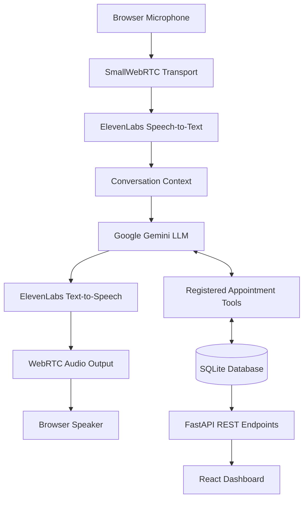

# CareLine AI

### Intelligent Voice-Powered Appointment Assistant

CareLine AI is a real-time, browser-based AI receptionist that enables patients to check doctor availability, book appointments, and cancel existing appointments through natural voice conversations.

The application combines a conversational AI voice pipeline with an interactive appointment management dashboard, providing a seamless experience without requiring login, OTP verification, or manual appointment forms.

Developed for the **NexovAI Software Development Engineer Internship – Round 1 Assessment**.

---

## 1. Key Features

- Real-time, two-way voice communication through the browser.
- Natural conversational interaction using Google Gemini.
- ElevenLabs speech-to-text and text-to-speech integration.
- Doctor availability checking through LLM function calling.
- Appointment booking and cancellation using spoken phone numbers.
- Phone number readback and explicit confirmation.
- Multiple appointment operations within a single conversation.
- Live conversation transcript.
- Automatically updated appointment dashboard.
- Doctor-specific availability filtering.
- Call duration timer, microphone mute, and speaking indicators.
- Persistent SQLite appointment storage.
- Protection against duplicate active bookings for the same slot.

---

## 2. Technology Stack

| Component | Technology |
|---|---|
| Frontend | React, TypeScript, Vite |
| Styling | CSS, Lucide React |
| Backend | Python 3.12, FastAPI |
| Voice orchestration | Pipecat |
| Speech-to-text | ElevenLabs Scribe v1 |
| Large language model | Google Gemini 3.5 Flash-Lite |
| Text-to-speech | ElevenLabs Flash v2.5 |
| Voice transport | SmallWebRTC |
| Voice activity detection | Silero VAD |
| Database | SQLite |
| API server | Uvicorn |

---

## 3. System Architecture



### Voice Pipeline

The application uses Pipecat to orchestrate the real-time conversational voice pipeline.

1. The browser captures microphone audio and streams it through SmallWebRTC.
2. Silero VAD assists with speech activity detection and turn-taking.
3. ElevenLabs converts the user's speech into text.
4. Google Gemini processes the conversation context and determines the appropriate response or appointment operation.
5. Registered function tools execute appointment-related database operations.
6. ElevenLabs converts the assistant's response into speech.
7. Generated audio is streamed back to the browser.
8. The frontend displays conversation transcripts and periodically refreshes appointment data.

---

## 4. LLM Function Calling

The assistant uses three registered function tools to interact with the appointment database.

### check_doctor_availability

Retrieves available appointment slots based on the requested doctor, specialty, or date.

- Filters unavailable and already booked slots.
- Excludes past appointment times.
- Returns actual slot identifiers and appointment details.
- Prevents the assistant from inventing availability.

### book_appointment

Creates an appointment for a selected available slot.

- Validates the provided phone number.
- Requires explicit phone number confirmation.
- Checks slot availability before booking.
- Prevents duplicate active bookings for the same slot.
- Returns the booking confirmation and appointment details.

### cancel_appointment

Cancels an existing active appointment associated with a confirmed phone number.

- Validates the provided phone number.
- Requires phone number confirmation.
- Identifies active appointments associated with the number.
- Supports appointment selection when multiple active appointments exist.
- Releases the cancelled appointment slot for future bookings.

---

## 5. Phone Number Verification

CareLine AI uses a conversational phone number verification workflow.

1. The assistant requests the patient's phone number verbally.
2. The spoken number is captured through speech-to-text.
3. The assistant reads the number back digit by digit.
4. The patient explicitly confirms whether the number is correct.
5. The corresponding booking or cancellation operation is performed using the confirmed number.

If an incorrect or different phone number is provided, the assistant can request clarification or identify that no matching active appointment exists.

No login, OTP, or caller ID integration is required.

Phone number confirmation verifies the supplied number within the conversation; it is not an authentication mechanism or proof of phone ownership.

---

## 6. Dashboard

The React dashboard provides a centralized interface for interacting with the AI receptionist and monitoring appointment activity.

### Voice Assistant

- Start and end voice calls.
- Mute and unmute the microphone.
- Display connection and speaking states.
- Track call duration.
- Display an animated speaking indicator.

### Live Transcript

- Displays user and assistant messages in real time.
- Groups consecutive assistant transcript fragments.
- Automatically scrolls to the latest message.

### Appointment Management

- Displays available doctors and specialties.
- Lists available appointment slots.
- Supports doctor-specific filtering.
- Displays active booking counts.
- Displays booked and cancelled appointment records.
- Masks phone numbers in the appointment table.
- Automatically refreshes dashboard data every 2.5 seconds.

---

## 7. Project Structure

```text
careline-ai/
│
├── backend/
│   ├── main.py
│   ├── bot.py
│   ├── database.py
│   ├── tools.py
│   ├── agent_tools.py
│   ├── prompts.py
│   ├── requirements.txt
│   └── .env.example
│
├── frontend/
│   ├── src/
│   │   ├── App.tsx
│   │   ├── App.css
│   │   ├── api.ts
│   │   ├── voice.ts
│   │   ├── index.css
│   │   └── main.tsx
│   ├── package.json
│   ├── package-lock.json
│   ├── index.html
│   └── vite.config.ts
│
├── .gitignore
└── README.md
```

The SQLite database is generated automatically during application initialization.

---

## 8. Installation and Setup

### Prerequisites

- Python 3.12
- Node.js 24 or a compatible Node.js version
- npm
- Git
- Google Gemini API key
- ElevenLabs API key with speech-to-text and text-to-speech access
- A browser with microphone access

### Step 1: Clone the Repository

Clone this repository using its GitHub URL and navigate to the project directory.

```bash
git clone <repository-url>
cd careline-ai
```

### Step 2: Set Up the Backend

Open a terminal in the project directory.

```powershell
cd backend

python -m venv .venv

.\.venv\Scripts\Activate.ps1

python -m pip install -r requirements.txt
```

### Step 3: Configure Environment Variables

Create a local `.env` file using the provided example.

```powershell
Copy-Item .env.example .env
```

Update the `.env` file with valid API credentials.

```env
ELEVENLABS_API_KEY=your_elevenlabs_api_key
GOOGLE_API_KEY=your_google_api_key

GEMINI_MODEL=gemini-3.5-flash-lite
ELEVENLABS_VOICE_ID=EXAVITQu4vr4xnSDxMaL
```

The configured ElevenLabs voice is Sarah, a premade voice.

API keys must remain private and should never be committed to version control.

### Step 4: Start the Backend

```powershell
python -m uvicorn main:app --host 127.0.0.1 --port 8000
```

Backend URL:

```text
http://127.0.0.1:8000
```

FastAPI documentation:

```text
http://127.0.0.1:8000/docs
```

Keep the backend running.

### Step 5: Set Up the Frontend

Open a separate terminal from the project root.

```powershell
cd frontend

npm ci

npm run dev
```

Frontend URL:

```text
http://localhost:5173
```

Open the frontend URL in a browser and grant microphone permission when requested.

---

## 9. API Endpoints

| Method | Endpoint | Description |
|---|---|---|
| GET | / | Backend service status |
| GET | /api/doctors | Retrieve doctor information |
| GET | /api/slots | Retrieve available appointment slots |
| GET | /api/appointments | Retrieve appointment records |
| POST | /api/offer | Establish the WebRTC voice connection |

---

## 10. Database Design

The application uses SQLite for persistent local storage.

### Doctors

Stores doctor names and medical specialties.

### Slots

Stores doctor-specific appointment dates and times.

### Appointments

Stores appointment identifiers, selected slots, phone numbers, booking status, and creation timestamps.

Appointment statuses:

- BOOKED
- CANCELLED

The database is initialized with four sample doctors across different specialties and seven days of appointment slots.

Database constraints and transactional booking operations help prevent duplicate active bookings.

---

## 11. Example Voice Conversation

**Assistant:** Hello, welcome to CareLine. How can I help you today?

**User:** Is Dr. Ananya Rao available tomorrow?

**Assistant:** Dr. Ananya Rao has available appointments at 9:00 AM, 10:30 AM, and 12:00 PM.

**User:** Please book the 10:30 AM appointment.

**Assistant:** Certainly. May I have your phone number?

**User:** My phone number is 9999900001.

**Assistant:** Let me confirm your number: nine, nine, nine, nine, nine, zero, zero, zero, zero, one. Is that correct?

**User:** Yes, that is correct.

**Assistant:** Your appointment has been booked successfully.

**User:** Actually, I would like to cancel that appointment.

**Assistant:** Let me confirm the phone number associated with your appointment.

**User:** Yes, that is correct. Please cancel my appointment.

**Assistant:** Your appointment has been cancelled successfully.

This is an illustrative conversation. Actual responses and available appointment times depend on the conversation context and database state.

---

## 12. Testing and Validation

The following scenarios were manually tested during development.

| Test Scenario | Result |
|---|---|
| Backend connectivity | Passed |
| Doctor availability retrieval | Passed |
| Browser-based voice connection | Passed |
| ElevenLabs speech recognition | Passed |
| Gemini conversational responses | Passed |
| ElevenLabs speech generation | Passed |
| Appointment booking | Passed |
| Appointment cancellation | Passed |
| Phone number readback and booking confirmation | Passed |
| Different phone number handling | Passed |
| Duplicate active slot protection | Implemented |
| Multiple appointment operations in one call | Passed |
| Automatic dashboard updates | Passed |
| Live transcript display | Passed |
| Frontend production build | Passed |

The complete availability, booking, and cancellation workflow was successfully exercised within a single continuous voice call.

---

## 13. Design Decisions and Limitations

- SQLite was selected to keep the assessment lightweight and easy to reproduce.
- The application uses simulated doctor and appointment data rather than an external hospital management system.
- Dashboard synchronization uses periodic REST API polling.
- The waveform is a visual speaking-state indicator, not a measured audio-amplitude visualization.
- Voice quality and response latency depend on network connectivity and external API availability.
- Gemini and ElevenLabs usage is subject to provider quotas and API access.
- Phone number confirmation is conversational verification, not secure patient authentication.
- The application is an assessment prototype intended for local demonstration, not a production healthcare system.

---

## 14. Security and Configuration

- API credentials are stored in local environment variables.
- The `.env.example` file provides a configuration template without real credentials.
- Local environment files, databases, virtual environments, and generated dependencies are excluded from version control.
- Phone numbers are partially masked in the dashboard.
- The assistant does not provide medical diagnoses or treatment recommendations.

---

## 15. Conclusion

CareLine AI demonstrates how real-time voice AI, LLM function calling, persistent appointment management, and a responsive web dashboard can be integrated into a unified conversational receptionist application.

The project focuses on natural interaction, reliable appointment operations, conversational phone number confirmation, and synchronized dashboard updates.

---

## Author

**Awala Aishwarya**

B.Tech – Computer Science and Engineering  
Artificial Intelligence and Machine Learning

Developed as part of the NexovAI SDE Internship Assessment.
